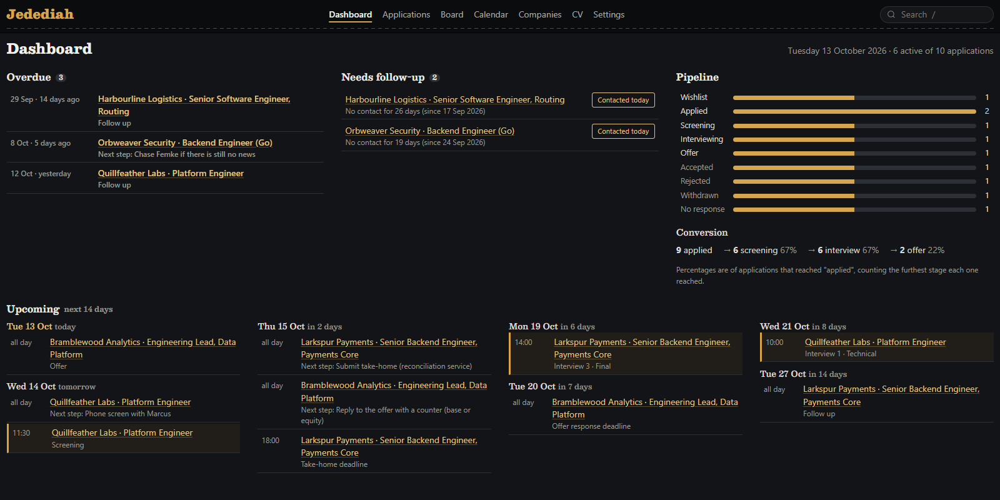
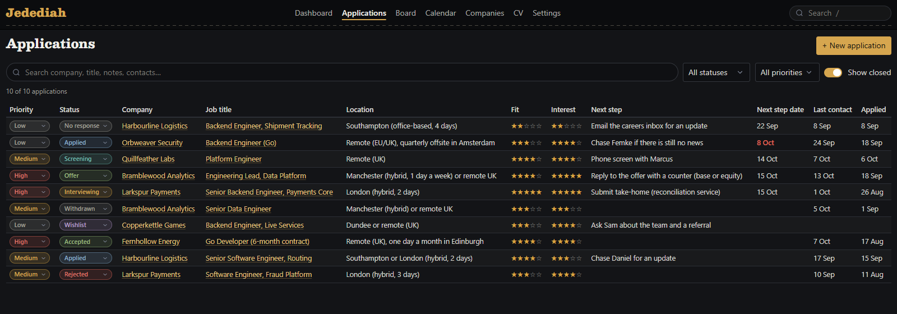
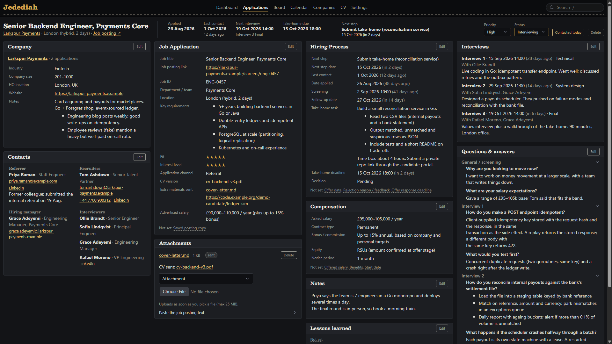
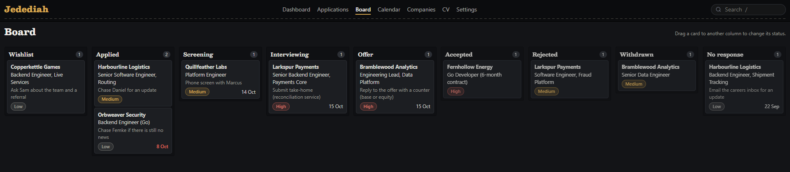

# Jedediah

_Named for Jedediah Smith (1799–1831), fur trapper and pathfinder of the American West._

Jedediah tracks your job applications. It runs on your own computer and you use it in the browser:
where you applied, who you talked to, upcoming interviews, and what to do next and when. Your data
stays on your machine as plain YAML files you can read and back up. There is no account and no
cloud, and it works offline.



Every application in one table, which you can filter, sort, and search:



Everything about one application on one page: company, contacts, the posting, the hiring process,
interviews, questions and answers, compensation, and notes. Click any field to edit it.



A board to drag applications from one status to the next:



There is also a calendar (with an `.ics` export for Outlook or Google Calendar), a CV library, a
CSV export, and a ZIP backup.

## Run it

### With Docker

Install [Docker Desktop](https://www.docker.com/products/docker-desktop/), then run this in a terminal:

```bash
docker run -d --name jedediah -p 127.0.0.1:8765:8765 -v "$HOME/Jedediah:/data" g2hjei/jedediah
```

Open http://localhost:8765. 

Optional arguments:

`$HOME/Jedediah` changes the data directory for the Jedediah data files.

`-e TZ=<timezone>` sets the timezone. This is important for the calendar to display the correct time. Defaults to `UTC`.

`--restart unless-stopped` Restarts Jedediah after a crash and whenever Docker starts..


### As a Windows `.exe`

Install [Go](https://go.dev/dl/) (1.27 or newer) and [Git](https://git-scm.com/downloads), then
run this in a terminal:

```bash
git clone https://github.com/G2HJei/jedediah.git
cd jedediah
go build -o jedediah.exe ./cmd/jedediah
```

Put `jedediah.exe` in any folder and double-click it. It opens Jedediah in your browser and keeps
your data in a `data` folder next to itself. To stop it, right-click the Jedediah icon in the tray
and choose **Quit**.

Run one or the other, not both: they use the same port.

## More

[SPECS.md](SPECS.md) has the details: every feature, where your data lives and how to back it up,
the command-line flags, security, more Docker options, and how to develop Jedediah.

GPL-3.0, see [LICENSE](LICENSE).
